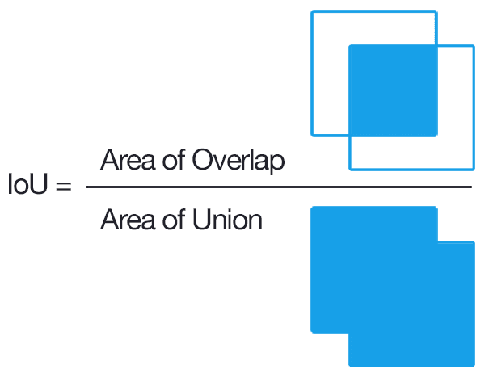
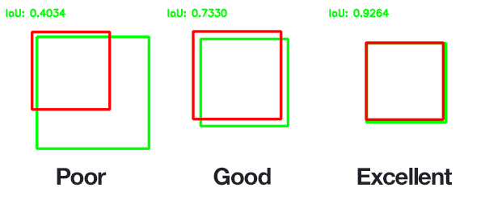
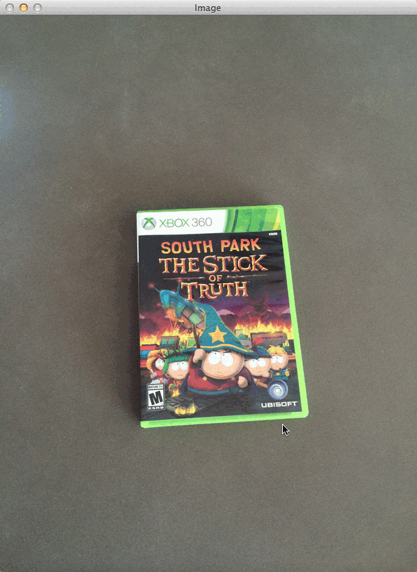
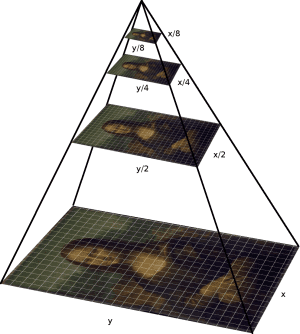
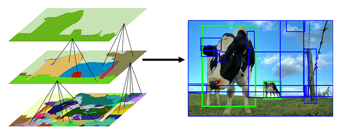

# Lab Guide: Region Proposal Algorithms & Non-Maximum Suppression

**Course:** Computer Vision (Master's Degree)  
**Goal:** Understand how object detection pipelines generate candidate regions—and implement **IoU**, **Non-Maximum Suppression (NMS)**, **Sliding Window**, **Image Pyramid Search**, and **Simplified Selective Search** from scratch.

---

## 1. Why Do Region Proposals Matter?

Imagine you have a classifier that can look at a small cropped image and answer: *"Is there a target object inside this box?"*  
The problem is: **where in the full image should you crop?**

An object could be anywhere in the image, and it could be tiny or huge. A **region proposal algorithm** solves this by suggesting a list of candidate bounding boxes to check.

In this lab, you will build and compare three generations of region proposal methods:

1. **Fixed-Size Sliding Window:** The simplest brute-force approach (one box size, scanned everywhere).
2. **Image Pyramid Search:** Multi-scale brute-force (resize the image to catch small and large objects).
3. **Simplified Selective Search:** Smart, data-driven grouping (merge similar regions bottom-up, the key idea behind R-CNN).

You will also implement **Non-Maximum Suppression (NMS)** to clean up duplicate overlapping detections.

---

## 2. Ground Rules & Pre-Built Code

Before writing any code, make sure you understand the conventions already set up in your starter script:

* **Bounding Box Format:** Every single box in this lab is a list or array of $4$ numbers:
  $$[x_1, y_1, x_2, y_2]$$
  where $(x_1, y_1)$ is the **top-left** corner and $(x_2, y_2)$ is the **bottom-right** corner in pixel coordinates.
* **Image Axes:** In NumPy/OpenCV, `image.shape` returns `(height, width, channels)`. Remember that $y$ corresponds to **height (rows)** and $x$ corresponds to **width (columns)**.
* **What is already built for you (do not modify):**
  * `create_benchmark_scene()`: Creates a $480 \times 640$ test image with $3$ target objects (crimson outer border + cyan inner core) at $3$ different scales ($44 \times 44$, $92 \times 92$, and $164 \times 164$), plus $3$ colored distractors.
  * `score_proposal(image, box)`: Simulates a classifier. It crops your proposed box, resizes it to $32 \times 32$, and outputs a confidence score in $[0.0, 1.0]$.
  * `extract_region_features(image, labels)`: Computes initial bounding boxes, pixel counts, color histograms, and neighbor pairs for Selective Search.
  * `evaluate_and_visualize(...)`: Runs your proposals through the classifier, calls your NMS function, prints performance metrics, and plots the results.

---

## 3. Task 1: Intersection-over-Union (IoU) & Non-Maximum Suppression

### Part 1A: `compute_iou(box_a, box_b)`

**Intuition:** How do we measure how much two boxes overlap? We divide the area where they overlap (**Intersection**) by the total area covered by both boxes combined (**Union**):

$$\text{IoU}(A, B) = \frac{\text{Area}(A \cap B)}{\text{Area}(A \cup B)}$$

An IoU of $0.0$ means no overlap at all; an IoU of $1.0$ means the two boxes are identical.

[Online Tutorial](https://pyimagesearch.com/2015/03/23/sliding-windows-for-object-detection-with-python-and-opencv/)

#### Step-by-step recipe to implement:

1. **Find the overlapping rectangle coordinates:**
   * Top-left of intersection:
     $$x_{\text{inter},1} = \max(a_{x1}, b_{x1}), \quad y_{\text{inter},1} = \max(a_{y1}, b_{y1})$$
   * Bottom-right of intersection:
     $$x_{\text{inter},2} = \min(a_{x2}, b_{x2}), \quad y_{\text{inter},2} = \min(a_{y2}, b_{y2})$$
2. **Compute intersection width and height (guard against no overlap!):**
   * If the boxes do not touch, $x_{\text{inter},2} - x_{\text{inter},1}$ will be negative. Clamp it to $0$:
     $$w_{\text{inter}} = \max(0.0, \, x_{\text{inter},2} - x_{\text{inter},1}), \quad h_{\text{inter}} = \max(0.0, \, y_{\text{inter},2} - y_{\text{inter},1})$$
   * $\text{Area}_{\text{inter}} = w_{\text{inter}} \times h_{\text{inter}}$.
3. **Compute individual box areas:**
   * $\text{Area}_A = \max(0.0, a_{x2} - a_{x1}) \times \max(0.0, a_{y2} - a_{y1})$
   * $\text{Area}_B = \max(0.0, b_{x2} - b_{x1}) \times \max(0.0, b_{y2} - b_{y1})$
4. **Compute union area and divide:**
   * Remember not to double-count the intersection:
     $$\text{Area}_{\text{union}} = \text{Area}_A + \text{Area}_B - \text{Area}_{\text{inter}}$$
   * Return $\frac{\text{Area}_{\text{inter}}}{\text{Area}_{\text{union}} + 10^{-6}}$ as a Python `float` (adding $10^{-6}$ avoids division by zero).

---

### Part 1B: `non_maximum_suppression(boxes, scores, iou_threshold=0.35)`

**Intuition:** A detector often fires $5$ or $10$ times around the exact same object with slightly shifted boxes. **NMS** keeps only the single most confident box for each object and deletes its overlapping duplicates.

#### Step-by-step recipe to implement:

1. **Handle the empty case:** If `len(boxes) == 0`, return an empty list `[]`.
2. **Sort by confidence (highest first):** Create an array `order` containing the indices of `boxes` sorted in **descending** order of `scores` (Hint: `np.argsort(scores)[::-1]`).
3. **Initialize an empty list:** `keep = []`.
4. **Loop while `len(order) > 0`:**
   * Take the first index `best_idx = int(order[0])` (this has the highest remaining score) and append it to `keep`.
   * If `len(order) == 1`, break out of the loop.
   * Look at all remaining indices `remaining = order[1:]`.
   * Compute the IoU between `boxes[best_idx]` and every box in `remaining`.
   * **Suppress duplicates:** Update `order` to keep **only** the indices in `remaining` whose IoU is $\le \text{iou\_threshold}$.
5. **Return `keep`** (a list of integer indices).

> **Sanity Check:** The starter script includes `verify_nms_against_opencv()`, which compares your NMS output against OpenCV's built-in `cv2.dnn.NMSBoxes`. When your code is right, both will print `[0, 2]`.  
> *(Note: Standard tabular ML libraries like `scikit-learn` do not include NMS because suppression depends on 2D spatial overlap rather than vector distance—computer vision libraries like OpenCV and `torchvision.ops.nms` provide it instead.)*

---

## 4. Task 2: Fixed-Size Sliding Window

### Function: `fixed_sliding_window(image, window_size=(64, 64), stride=16)`

**Intuition:** Imagine sliding a cardboard frame of size $w_{\text{win}} \times h_{\text{win}}$ across a photograph, left-to-right and top-to-bottom, jumping by `stride` pixels each step. Every position gives you one candidate box.

[Online Tutorial](https://pyimagesearch.com/2015/03/16/image-pyramids-with-python-and-opencv/)

#### Step-by-step recipe to implement:

1. Read image height $H$ and width $W$ from `image.shape[:2]`, and unpack `win_w, win_h = window_size`.
2. Create an empty list `proposals = []`.
3. Write two nested `for` loops:
   * Outer loop over vertical positions `y`: from $0$ up to $H - h_{\text{win}}$ (inclusive, so use `range(0, H - win_h + 1, stride)`).
   * Inner loop over horizontal positions `x`: from $0$ up to $W - w_{\text{win}}$ (inclusive, so use `range(0, W - win_w + 1, stride)`).
4. Inside the inner loop, append `[x, y, x + win_w, y + win_h]` to `proposals`.
5. Return `proposals`.

> **What should happen when you run this?**  
> Don't panic if you see **0.0% recall**! With a fixed $64 \times 64$ window, the small target ($44 \times 44$), medium target ($92 \times 92$), and large target ($164 \times 164$) all have a theoretical maximum IoU below $0.50$:
> $$\text{IoU}_{\max} = \frac{\min(\text{Area}_{\text{window}}, \, \text{Area}_{\text{GT}})}{\max(\text{Area}_{\text{window}}, \, \text{Area}_{\text{GT}})}$$
> For example, on the small object: $\frac{44^2}{64^2} = \frac{1936}{4096} \approx 0.47 < 0.50$. This demonstrates **scale blindness**, which motivates Task 3!

---

## 5. Task 3: Multi-Scale Image Pyramid Search

### Function: `pyramid_sliding_window(image, window_size=(64, 64), stride=16, scales=(0.40, 0.55, 0.70, 1.0, 1.4, 1.8))`

**Intuition:** Instead of resizing the window, keep your $64 \times 64$ window fixed and **resize the image** to multiple scales:

* **Scale $> 1.0$ (zoom in / enlarge image):** Makes *small* objects appear bigger so they fit inside the $64 \times 64$ window.
* **Scale $< 1.0$ (zoom out / shrink image):** Makes *large* objects appear smaller so they fit inside the $64 \times 64$ window.

[Online Tutorial](https://pyimagesearch.com/2020/06/29/opencv-selective-search-for-object-detection/)

#### Step-by-step recipe to implement:

1. Read original `img_h, img_w = image.shape[:2]` and initialize `proposals = []`.
2. Loop over each `scale` in `scales`:
   * Compute new dimensions:
     $$W_s = \text{round}(W \times \text{scale}), \quad H_s = \text{round}(H \times \text{scale})$$
     (convert both to `int`).
   * **Safety check:** If $W_s < w_{\text{win}}$ or $H_s < h_{\text{win}}$, skip this scale (`continue`).
   * Resize the image using `cv2.resize(image, (W_s, H_s), interpolation=cv2.INTER_LINEAR)`.  
     *(Careful: OpenCV's `cv2.resize` takes `(width, height)`, not `(height, width)`!)*
   * Call your `fixed_sliding_window(resized_img, window_size, stride)` to get boxes in the *scaled* image.
   * **Back-project coordinates to the original image:** For every scaled box `[x1, y1, x2, y2]`, divide all $4$ coordinates by `scale`:
     $$\left[\frac{x_1}{\text{scale}}, \, \frac{y_1}{\text{scale}}, \, \frac{x_2}{\text{scale}}, \, \frac{y_2}{\text{scale}}\right]$$
     and append it to `proposals`.
3. Return `proposals`.

---

## 6. Task 4: Simplified Selective Search

**Intuition:** Scanning $7{,}000+$ grid windows wastes massive amounts of compute on empty background. **Selective Search** [(Uijlings et al., 2013)](https://link.springer.com/article/10.1007/s11263-013-0620-5) works *bottom-up*:

1. Start by grouping nearby similar pixels into small patches called **superpixels** (using the SLIC algorithm).
2. Repeatedly **merge the two most similar adjacent regions** into a bigger region until the whole image becomes one single region.
3. Save the bounding box of every initial region and every newly merged region as a proposal!

Because superpixels hug real object boundaries, this finds objects of **all sizes** with **10$\times$ fewer proposals** than a pyramid search.

---

### Part 4A: `compute_region_similarity(reg_a, reg_b, img_area)`

Each region dictionary (created by the pre-built `extract_region_features` helper) has three keys:
* `"bbox"`: `[x1, y1, x2, y2]`
* `"size"`: number of pixels in the region (integer)
* `"hist"`: normalized $48$-bin color histogram (1D NumPy array summing to $1.0$)

You must compute the combined similarity score:

$$s(r_a, r_b) = s_{\text{color}}(r_a, r_b) + s_{\text{size}}(r_a, r_b) + s_{\text{fill}}(r_a, r_b)$$

#### The 3 formulas to implement:
1. **Color similarity ($s_{\text{color}}$):** How similar are their color histograms? Use **histogram intersection**:
   $$s_{\text{color}} = \sum_{k=1}^{48} \min(h_a[k], \, h_b[k])$$
   *(Hint: in NumPy this is a single line with `np.minimum(...).sum()`.)*
2. **Size similarity ($s_{\text{size}}$):** Encourages small regions to merge early so large background regions don't swallow everything right away:
   $$s_{\text{size}} = 1.0 - \frac{\text{size}_a + \text{size}_b}{\text{img\_area}}$$
3. **Fill similarity ($s_{\text{fill}}$):** Measures how tightly the two regions fit together inside their combined bounding box $BB_{ab}$ (avoids merging regions that leave huge empty gaps):
   * Compute the enclosing box of `reg_a["bbox"]` and `reg_b["bbox"]`:
     $$x_{1} = \min(a_{x1}, b_{x1}), \quad y_{1} = \min(a_{y1}, b_{y1}), \quad x_{2} = \max(a_{x2}, b_{x2}), \quad y_{2} = \max(a_{y2}, b_{y2})$$
   * Compute $\text{Area}(BB_{ab}) = (x_2 - x_1) \times (y_2 - y_1)$.
   * Compute:
     $$s_{\text{fill}} = 1.0 - \frac{\text{Area}(BB_{ab}) - \text{size}_a - \text{size}_b}{\text{img\_area}}$$
4. **Return** `float(s_color + s_size + s_fill)`.

---

### Part 4B: `_selective_search_single_scale(image, n_segments)` and `simplified_selective_search(image, segment_scales=(110, 260))`

#### Step-by-step recipe for `_selective_search_single_scale(image, n_segments)`:

1. Compute `img_area = float(img_h * img_w)`.
2. **Generate initial superpixels:**
   * Convert `image` from BGR to RGB (`cv2.cvtColor(image, cv2.COLOR_BGR2RGB)`), because `skimage.segmentation.slic` expects RGB input.
   * Run `labels = slic(image_rgb, n_segments=n_segments, compactness=15, start_label=0)`.
   * Call the pre-built helper: `regions, neighbors = extract_region_features(image, labels)`.
3. **Initialize tracking structures:**
   * `proposals = [reg["bbox"] for reg in regions.values()]`
   * `next_id = max(regions.keys()) + 1` (each merged region gets a fresh integer ID).
   * Build a dictionary `similarities` mapping each neighbor tuple `(a, b)` in `neighbors` to `compute_region_similarity(regions[a], regions[b], img_area)`.
4. **Greedy hierarchical merging loop (`while similarities:`):**
   * **Step A (Pick best pair):** Find the pair `(i, j)` in `similarities` with the **maximum** similarity score (Hint: `max(similarities, key=similarities.get)`).
   * **Step B (Create merged region `t = next_id`, then increment `next_id`):**
     * $\text{size}_t = \text{size}_i + \text{size}_j$
     * $\text{bbox}_t = [\min(x_{1,i}, x_{1,j}), \, \min(y_{1,i}, y_{1,j}), \, \max(x_{2,i}, x_{2,j}), \, \max(y_{2,i}, y_{2,j})]$
     * **Fast histogram update** (no need to re-read image pixels!):
       $$h_t = \frac{\text{size}_i \cdot h_i + \text{size}_j \cdot h_j}{\text{size}_t}$$
     * Store `regions[t] = {"bbox": merged_bbox, "size": merged_size, "hist": merged_hist}` and append `merged_bbox` to `proposals`.
   * **Step C (Update the neighbor graph):**
     * Create an empty set `merged_neighbors = set()`.
     * Loop over `list(similarities.keys())`: if either endpoint `a` or `b` is equal to `i` or `j`:
       * Delete `(a, b)` from `similarities`.
       * Find the `other` endpoint; if `other` is not in `(i, j)`, add `other` to `merged_neighbors`.
     * For every `other` in `merged_neighbors`:
       * Form the canonical pair `pair = (min(t, other), max(t, other))`.
       * Compute and store `similarities[pair] = compute_region_similarity(regions[t], regions[other], img_area)`.
5. **Return `proposals`.**

#### Multi-Scale Wrapper: `simplified_selective_search(image, segment_scales=(110, 260))`

Why do we run two SLIC scales (`110` and `260`)?

* With only $110$ coarse superpixels on a $480 \times 640$ image, each superpixel averages $\approx 53 \times 53$ pixels—bigger than our $44 \times 44$ small target! Because Selective Search only **merges** and never **splits**, a coarse superpixel can swallow a small object together with background.
* Adding a finer pass (`260` superpixels) cleanly captures small objects while keeping the total proposal count very low.

**Implementation:** Loop over `n_seg` in `segment_scales`, call `_selective_search_single_scale(image, n_seg)`, store boxes as tuples inside a Python `set` to remove exact duplicates, and return `[list(box) for box in unique_boxes]`.

---

## 7. Expected Results (Self-Check Table)

Once you complete all four tasks and run the script, your console output should closely match these benchmark numbers:

| Method                             |  Total Proposals  | Best IoU per GT (Small / Med / Large) | Proposal Recall ($\text{IoU} \ge 0.5$) | Raw Hits $\rightarrow$ After NMS | Detection Recall / Precision |
| :--------------------------------- | :---------------: | :-----------------------------------: | :------------------------------------: | :------------------------------: | :--------------------------: |
| **1. Fixed Sliding Window**        |   $\approx 999$   |      $[0.47, \, 0.48, \, 0.15]$       |                $0.0\%$                 |        $0 \rightarrow 0$         |       $0.0\% / 0.0\%$        |
| **2. Image Pyramid Search**        | $\approx 7{,}399$ |      $[0.93, \, 0.73, \, 0.78]$       |               $100.0\%$                |        $4 \rightarrow 3$         |     $100.0\% / 100.0\%$      |
| **3. Simplified Selective Search** |   $\approx 648$   |      $[1.00, \, 0.99, \, 0.98]$       |               $100.0\%$                |        $10 \rightarrow 3$        |     $100.0\% / 100.0\%$      |
